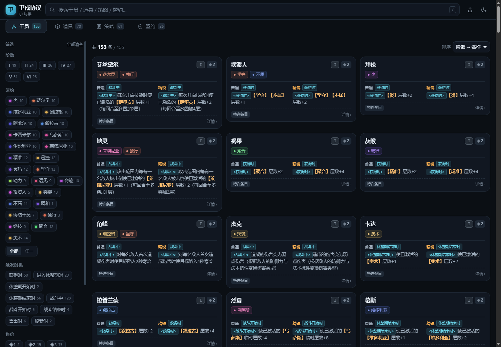
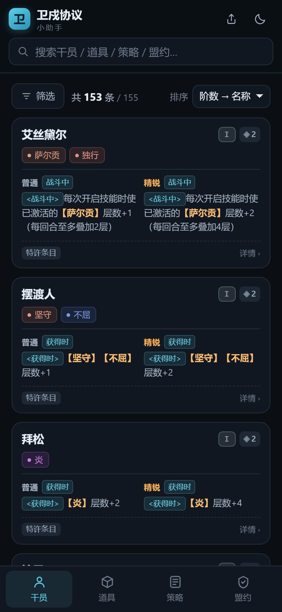
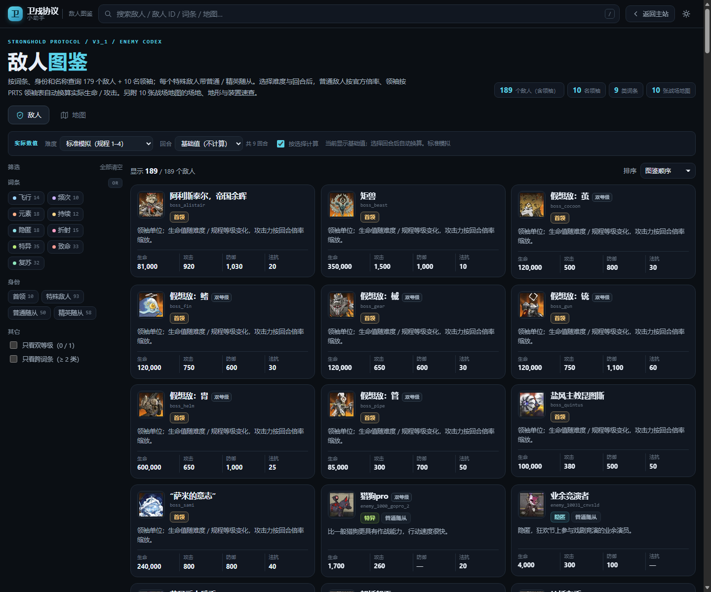

# GSPA · 眼镜卫戍协议小助手

**GSPA** : **G**lasses **S**tronghold **P**rotocol **A**ssistant（眼镜卫戍协议小助手）。

本网页由 [@眼镜](https://space.bilibili.com/20597523) 提议，[@海星君](https://space.bilibili.com/341607034) 开发。
思路提供、测试：[@夕阳](https://space.bilibili.com/327907133) 等星海攻略组成员

关注眼镜谢谢喵　关注海星谢谢喵　关注星海攻略组谢谢喵

[星海攻略组卫戍协议直播间](https://live.bilibili.com/22354757)，每晚 18:30 开播

在线访问地址：<https://haixingjun.github.io/GSPA-Glasses-Stronghold-Protocol-Assistant/>

## 功能介绍

- **图鉴**：快速查找干员、盟约、装备/道具、策略
- **搜索**：快速搜索想查找的干员、道具、策略、盟约（特殊干员的别称、职业、技能名也进索引）
- **筛选**：按阶数、盟约、触发时机、售价等组合筛选；干员 / 盟约卡片与筛选 chip 上的盟约标签统一为「盟约图标 + 名称」，主盟约后换行显示副盟约；自选干员使用与 I–VI 并列的「自选」阶数标签
- **敌人图鉴**：支持名称与敌人 ID 搜索、词条组合筛选；通过「难度 + 回合数」自动换算敌人数值；战场地图可查场地、地形、装置与适用难度，并支持筛选
- **模拟配队（BETA）**：模拟构建 8 人配队，自动点亮盟约、筛选叠层手段，并按盟约统计一回合叠层上限（只算已激活盟约）；支持导出**共享码**，也能生成**配队一图流**（盟约图标带 + 干员头像 + 叠层上限 + 扫码直达的二维码）
- **盟约状态配色**：未激活 / 待激活为灰色，激活为绿色，强化为金色；配队与沙盒统一
- **沙盒叠层（BETA）**：从主页面导航进入，与「配队」同级。按官方地图图片选择「规程」战场（10 战场 × 场地 1/3，网格来自解包关卡，已裁掉装备区/待部署区/敌人展示区），空白训练场部署、朝向与逐事件叠层；通用叠层规则已接入，依赖敌人状态 / 装备 / 招募的特殊效果暂未模拟；支持日志复制 / 诊断导出与 `GSPS1` 沙盒码分享

## 界面预览

<p align="center">
  
  
</p>
<p align="center">
  
</p>

## 快速开始

### 在线使用

直接打开 <https://haixingjun.github.io/GSPA-Glasses-Stronghold-Protocol-Assistant/>。支持手机与电脑，可切换深色 / 浅色主题。

### 本地运行

项目没有构建步骤，`web/` 就是可直接运行的源码：

```bash
git clone https://github.com/Haixingjun/GSPA-Glasses-Stronghold-Protocol-Assistant.git
cd GSPA-Glasses-Stronghold-Protocol-Assistant
```

- 直接双击 `web/index.html` 即可打开（`file://` 下深链会退化为 hash，功能不受影响）；
- 或在 `web/` 下起一个静态服务器，方便手机在同一局域网访问：

```bash
cd web
python -m http.server 8080
# 打开 http://127.0.0.1:8080/
```

## 项目结构

```text
GSPA-Glasses-Stronghold-Protocol-Assistant/
├── 卫戍协议数据表.xlsx   # 唯一可编辑的数据源
├── web/                  # 前端源码，可直接双击 index.html 预览
├── tools/                # 数据构建与素材抓取脚本
├── data/                 # 头像、图标清单、盟约分类、特殊干员/领袖档案、难度回合倍率
├── source/               # 解包原始数据、PRTS wikitext 快照（溯源用）
├── dist/                 # 构建产物（由脚本生成，勿手改）
├── release/              # 按版本整理的可部署发布产物（如 release/GSPA-1.0.5/）
├── deploy/               # Nginx / Docker / 各托管平台的部署配置
└── docs/                 # 截图
```

各脚本的用法、数据口径与工程约定见 [开发说明.md](开发说明.md)。

## 部署

站点是纯静态的，构建后把 `dist/` 整个目录上传到任意能托管静态文件的地方即可（GitHub Pages、Cloudflare Pages、Nginx、对象存储等）。
推送到 `main` 后，GitHub Actions 会自动把 `dist/` 发布到 GitHub Pages（首次使用需在仓库 Settings → Pages → Source 选择 `GitHub Actions`）；详细步骤与各平台注意事项见 [deploy/README.md](deploy/README.md)。

另外，`dist/standalone.html` 是单文件版（约 612 KB，CSS、JS、数据全部内联），不含头像与图标，可离线双击打开或直接发给别人。

若需要直接分发的成品，见 [`release/`](release/) 下按版本整理的发布产物（当前为 [`GSPA-1.0.5`](release/GSPA-1.0.5/)）：每个版本目录都是自包含的静态站点，已剔除构建日志、测试与开发文档，可直接部署或打包。

## 版权与免责

本项目是**非官方、非商业**的玩家自用查询工具，与鹰角网络（Hypergryph）无任何隶属或合作关系。

- **游戏内容**：游戏名称、干员名、数值、技能与盟约文本，以及头像、道具 / 策略 / 盟约图标等美术素材，著作权均归**鹰角网络**所有。本项目仅作非商业的玩家查询与交流用途，不主张任何版权。
- **素材来源**：头像与图标抓取自 [PRTS Wiki](https://prts.wiki)，特殊干员的职业/属性/天赋/技能文本同样补充自 PRTS 干员页，仅下载后本地使用，不热链。PRTS 的内容采用 **CC BY-NC-SA**（署名—非商业性使用—相同方式共享），**因此本项目整体不得用于任何商业用途**。
- **数据来源**：`source/` 中的完整数据表来自官方热更包解包，仅用于核对与溯源；可编辑的唯一主表是根目录的 `卫戍协议数据表.xlsx`。
- **仅供参考**：本站数据由玩家整理，可能存在遗漏、笔误或版本滞后，不构成任何官方说明，一切以游戏内实际内容为准。因使用本站产生的任何后果由使用者自行承担。
- **无担保**：本项目按「现状」提供，不提供任何明示或默示的担保，包括但不限于准确性、完整性与特定用途适用性。
- **隐私**：本站不收集个人信息，没有账号体系，也不接入第三方统计；仅在浏览器本地保存主题与图片显示偏好（`localStorage`），清除浏览器数据即可移除。
- **权利人诉求**：如果权利人认为本仓库中的任何内容构成侵权，请通过 [GitHub Issue](https://github.com/Haixingjun/GSPA-Glasses-Stronghold-Protocol-Assistant/issues) 联系，会**立即删除**相关内容或整个仓库，无需任何前置条件。

完整的第三方素材清单与逐项授权说明见 [NOTICE.md](NOTICE.md)。

## 许可证

- **代码**：`tools/`、`web/` 下的 HTML / CSS / JS、`deploy/`、`.github/` 等本项目代码，以 [MIT License](LICENSE) 发布，Copyright (c) 2026 Haixingjun。
- **数据与素材**：游戏数据、文本、头像与图标的权利归鹰角网络所有，PRTS 相关内容遵循 CC BY-NC-SA。**这些内容不在 MIT 许可范围内**，不得单独提取或用于商业用途。
- 转载、二次开发或分发时，请保留本 README 中的版权与免责说明，以及 [LICENSE](LICENSE) 和 [NOTICE.md](NOTICE.md)。

## 反馈与致谢

- 发现数据错误、缺图或页面问题，欢迎提 [Issue](https://github.com/Haixingjun/GSPA-Glasses-Stronghold-Protocol-Assistant/issues)。数据类问题请附上干员 / 道具名称与游戏内截图，以便核对。
- 感谢 [PRTS Wiki](https://prts.wiki) 提供的素材与资料，感谢星海攻略组和各位测试者的反馈。

---

祝使用愉快
Haixingjun

